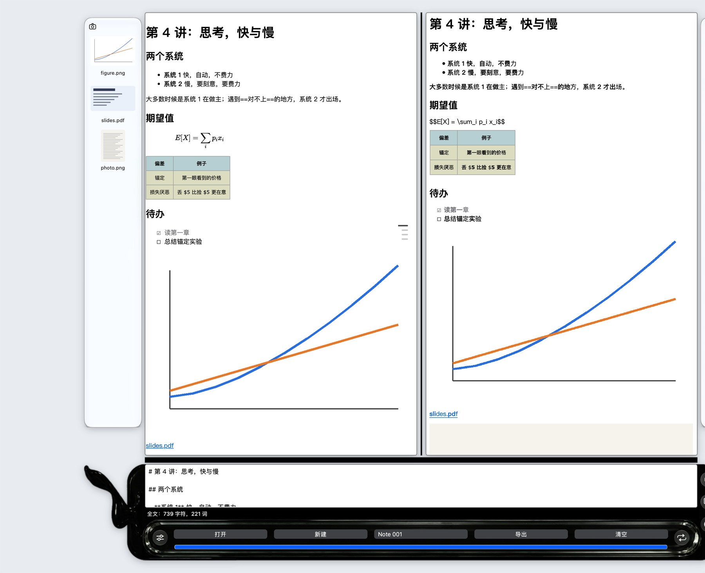
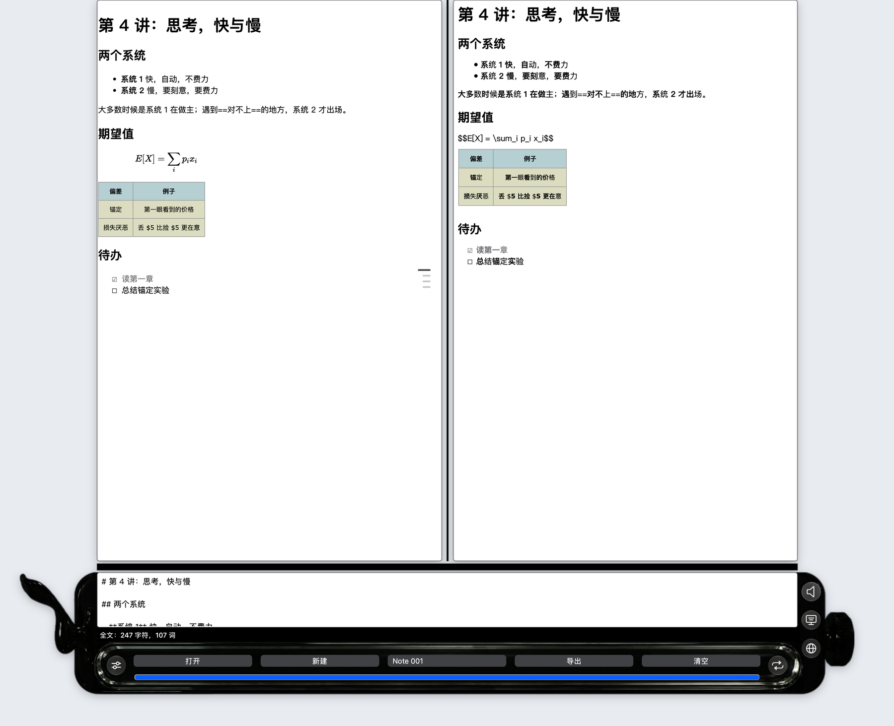
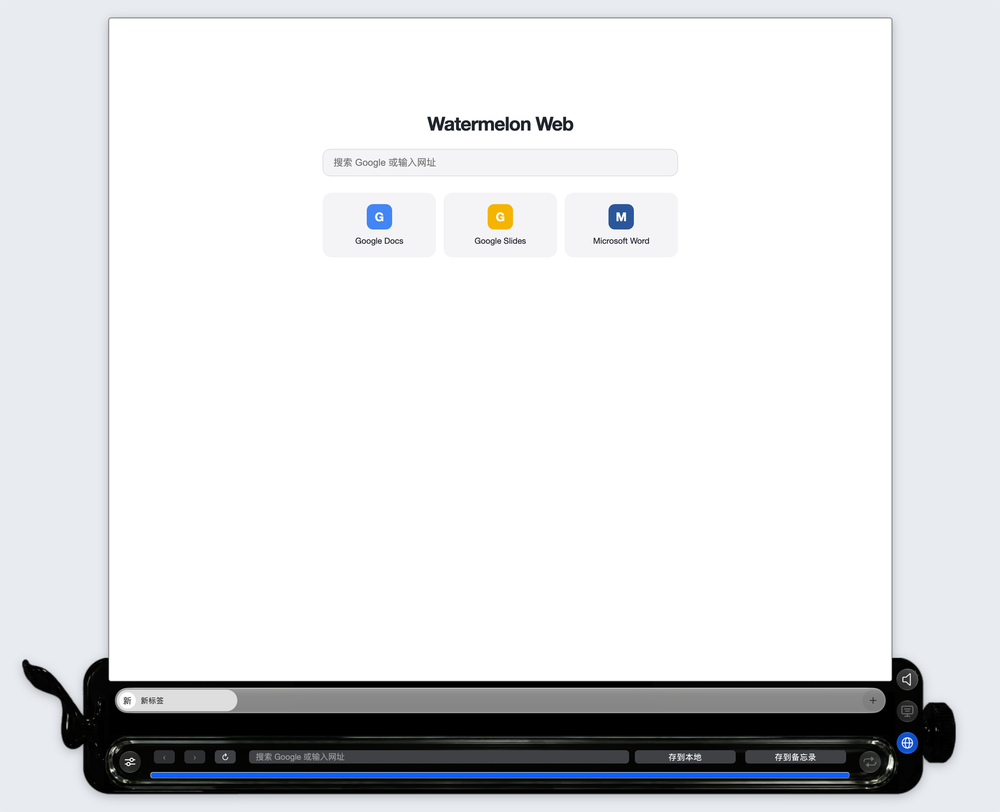
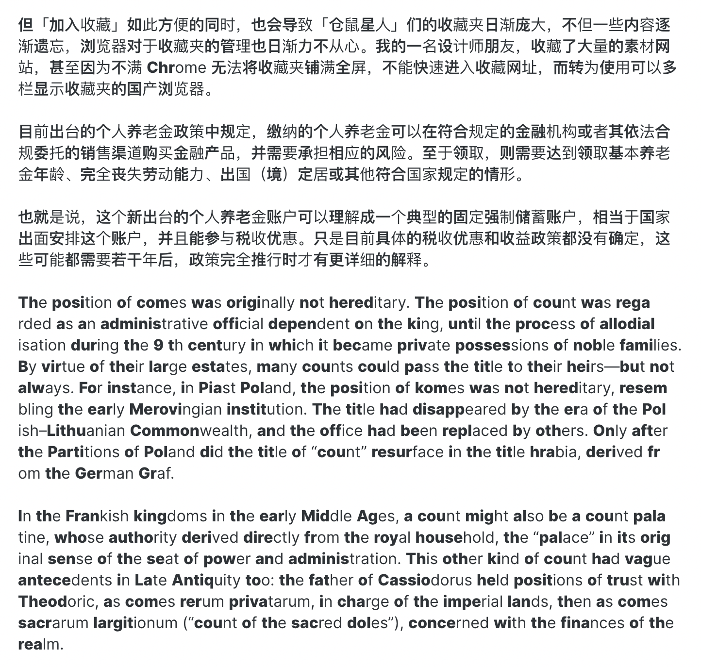
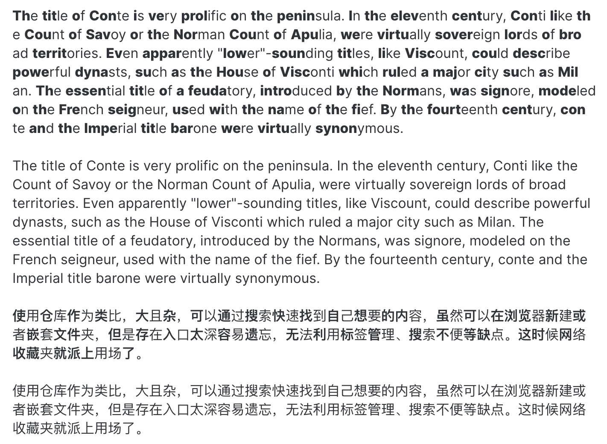

# 🍉Watermelon: A Markdown-based Tool for Bionic Reading

<p align="center"><b>简体中文</b> · <a href="README_EN.md">English</a> · <a href="README_JA.md">日本語</a></p>

<p align="center">
  
</p>

**Watermelon 是一台浮在 Mac 桌面上的 Markdown 打字机。** 一边打字，一边看到排好版的页面和「加粗阅读」（Bionic Reading）的版本。它能和 Apple 备忘录来回同步，能直接编辑 Word / Excel / PowerPoint，能把网页存成笔记；上课、开会时，附件、截图、拍下来的纸都收在编辑区旁边，装了 [Broccoli](https://github.com/Ryan-the-hito/Broccoli) 还能实时出讲解卡片。本地笔记都是你 Mac 上的普通 Markdown 文件。

最新版本：**v2.2.4** · 界面语言：English / 简体中文 / 日本語

<details>
<summary>旧版简介（v2.2.3 及更早）</summary>

~~Copy your text, click menu, paste it in your markdown editor, and enjoy fast reading!~~

~~Add bionic reading to day-to-day typing and reading experience.~~

</details>

## 解决问题

Watermelon 最初只做一件事：把剪贴板里的文字变成加粗阅读的格式，让你读得更快。后来它长成了一个写东西的地方，现在想解决三件事：

1. **写的时候看不到读的样子**

   Markdown 写起来快，但写的时候满屏符号，读的时候要换一个软件。Watermelon 把三样东西放在同一个窗口里：下面打字，左上是实时排好版的页面，右上是加粗阅读的版本。中文、英文、日文都能加粗。

2. **笔记被锁在某一个软件里**

   Apple 备忘录好用，但格式出不来；Word 文件、网页上的文档又各在各处。Watermelon 的笔记是普通的 Markdown 文件，同时能和备忘录来回同步并保住备忘录的原生格式，能在同一个编辑区里打开 Office 文件，能把网页（包括 Google 文档和幻灯片）一键存成本地文档或备忘录。

3. **听课、开会时，资料和笔记是分开的**

   课件在一个窗口，笔记在另一个窗口，老师说的话记不下来。Watermelon 把这张笔记的附件列在编辑区左边，截图和拍下来的纸也收在那里；右边是 AI 卡片：打开听课模式后，正在看的那一页、刚说完的那段话、正在写的那一段，会一起交给 Broccoli，讲解卡片实时出现，一键插进笔记。

## 功能亮点

### 打字机：三个视图

- **编辑区**：写 Markdown。修改自动保存，旧版本自动备份（菜单栏菜单「💾 备份份数上限」决定留几份）。
- **实时预览**：标题、列表、表格、代码块、公式都排出来。公式引擎自带，不联网。页面右边有一列大纲刻度，鼠标停上去展开成标题列表，点一下就跳过去。
- **加粗阅读**：每个词的前半部分加粗。长文档上每次只重排改动的那一块。
- 三块的大小可以拖动调整。打字有打字机的声音，右边的圆按钮可以关。
- **提词器模式**（菜单栏菜单「📺 提词器模式」或右边的圆按钮）。

### 剪贴板和文件的加粗阅读

- 复制一段文字，点菜单栏菜单「🦾 加粗文字！（剪贴板）」，剪贴板里的文字就变成加粗阅读的格式，贴到任何 Markdown 编辑器里都行；「💪 取消加粗！（剪贴板）」变回去。
- 「📂️ 打开 Markdown 文件」：把一个 Markdown 文件整个做成加粗阅读的版本。

### Apple 备忘录互通

- 打字机上的按钮可以在本地文档（Local）和备忘录（Notes）之间切换。选一张备忘录，就在 Watermelon 里用 Markdown 写它，改动同步回备忘录。
- 来回同步保得住备忘录原生的格式：引用、清单（勾选框）、小标题、#标签、链接、分隔线、表格、代码块，附件留在原来的位置。
- 选笔记的列表里，新建的排在最上面。字数那一行末尾显示保存状态。


<details>
<summary>备忘录同步支持的 Markdown 样式（示例）</summary>

```
# 一级标题 (H1)
## 二级标题 (H2)
### 三级标题 (H3)
## 1. 文本样式 (Text Styling)

这是一段普通文本。

**加粗文本 (Bold)**

*斜体文本 (Italic)*

***粗斜体 (Bold Italic)***

~~删除线 (Strikethrough)~~

**~~删除~~**~~线~~可以在**长文字**中对部分文字设置样式 *format* ~~(~~***~~Strikethrough~~***~~)~~

如果有两个相同的样式，中间有空格隔开，会自动将两个相同的样式连为一体

无序列表：

- **无序列表内加粗文本 (Bold)**
- 无序列表内粗斜体 ***(Bold Italic)***
- 无序列表内斜体文本 *(Italic)*
- ~~无序列表内删除线 (Strikethrough)~~

有序列表：（列表与列表之间必须有非列表文字，不然会识别为同一个列表的延续）

1. **有序列表内加粗文本 (Bold)**
2. 有序列表内斜体文本 *(Italic)*
3. 有序列表内粗斜体 ***(Bold Italic)***
4. ~~有序列表内删除线 (Strikethrough)~~

## 2. 列表 (Lists)

**无序列表：**

- 项目 A
- 项目 B
  - 子项目 B.1 (缩进)
  - 子项目 B.2

**有序列表：**

1. 第一步
2. 第二步
3. 第三步

## 3. 表格（只支持所有栏目居中显示）

| 功能名称 | 状态 | 耗时 |
| :---: | :---: | :---: |
| 数据导入 | ✅ 完成 | 50 ms |
| 数据处理 | 🔄 进行中 | 1200 ms |
| 结果导出 | ❌ 失败 | 0 ms |
```

代码块也可以正常转译：

```
def hello_world():
    print("Hello, Markdown!")
    return True
```

LaTeX 公式在 Watermelon 的预览里能排出来（Apple 备忘录自己无法渲染）：

行内公式：$a^2+b^2=c^2$

独立公式：$$\int_0^1 x^2 dx$$


</details>

### Word / Excel / PowerPoint

- Office 文件和其他文档用同一个文件下拉切换，直接在编辑区里打开、编辑，自动存回原文件。

### 网页模式

- 右边的 Web 圆按钮把编辑区整页换成网页，带标签栏；开始页有 Google Docs、Google Slides、Microsoft Word 的入口，登录状态会保留。
- 「存到本地」「存到备忘录」：把当前网页的内容（包括 Google 文档、幻灯片）一键存成本地文档或备忘录。

### 两侧的面板：附件和 AI 卡片

- **左边**：这张笔记里所有附件的列表，带缩略图。点一下在独立小窗里预览，可以同时开好几个；PDF 可以上下滚动或一页一页翻，还能直接拖选、复制里面的字。Word / Excel / PowerPoint 用系统的「快速查看」预览，一个按钮就能在编辑区打开。
- 把文件拖到列表、编辑框或排好版的页面上，就在笔记里加一个附件。附件右键可以从笔记里移除（⌘Z 能撤回，文件本身不动）。
- **右边**：AI 卡片面板（需要 Broccoli）。
- 两块面板都靠鼠标移到编辑区边上才出现的圆形把手拉出、收回，宽度刚好填满空条，不会盖到编辑区。

### 截图和拍照当课件

- 左边列表顶上的相机：第一次框出一块区域，之后每点一次就截同一块。有几块屏幕都能框，在哪块屏上按下就截哪块。区域重启后还记得。
- 截下来的图先放在列表里，跟着截图时打开的那张笔记，重启后还在，只有自己删才会删。每张右键可以插进笔记、合成 PDF（或加到笔记里已有的 PDF 后面）、删除；⌘ / ⇧ 点可以多选；也可以直接拖进编辑框。
- 用 Mac 的摄像头拍纸（自带摄像头、拍桌面的 Desk View、iPhone 接力相机）：自动找到纸、拉正、变清晰，并认出上面的字。合成的 PDF 里，字是一层看不见的文字，可以选中、复制、搜索。

### 听课模式（需要 Broccoli）

- 菜单栏菜单「🎓 听课模式」。打开后，Watermelon 把正在看的这一页课件、刚说完的一段话（Broccoli 的实时语音转写）、正在写的这一段笔记交给 Broccoli，右边面板里出现讲解卡片。卡片只讲「现在」的内容。
- 卡片可以一键插进笔记，插进去后自动归档；右键可以就某张卡片或选中的文字再问 Broccoli。
- PDF、Word、Excel、PowerPoint 里的高亮、批注、便签、演讲者备注，会作为卡片出现在右边面板，每条只出现一次。

### 和 Broccoli、其他 AI 软件一起用

需要另外安装 [Broccoli](https://github.com/Ryan-the-hito/Broccoli)。电脑上没有时，Watermelon 会先推荐下载。

- 编辑框右键「发给 Broccoli」：选中的文字（没选就是整篇）作为背景资料交给 Broccoli，文字里引用的图片、PDF 等文件也一起交过去。Broccoli 开一个空白对话等你提问。
- 编辑框右键「让 Broccoli 在此处续写…」：整篇笔记作为背景资料交给 Broccoli，在 Broccoli 里说要写什么；写好后自动打进你右键的位置。中间改了别处、换了笔记都没关系。一次 ⌘Z 可以整段撤回。
- 「🃏 制作 Anki 卡片…」：让 Broccoli 从选中的文字（可以带上附件里的几页）做 Anki 卡片（正反面或挖空），存进牌组文件夹，可以导入 Anki，之后还能往同一个牌组里加。
- Watermelon 的主要功能做成了 35 个 MCP 工具：文档、大纲、附件和截图、卡片、Anki 牌组、备忘录、网页模式、设置、备份。装了 Broccoli 会自动接上；别的 AI 软件点菜单栏菜单「🔌 在其他 AI 软件里使用…」复制设置，贴进那个软件的 MCP 设置里。

### 窗口

- 液态玻璃外观：打字机上的圆按钮、网页标签栏、侧面板是系统玻璃；独立窗口带系统红绿灯；提醒和菜单用系统自己的。
- 菜单栏菜单里的开关：「👀 显示/隐藏 Dock 图标」显示或隐藏 Dock 图标；「🪟 在所有空间显示」每个桌面和全屏软件上面都有。
- 开着台前调度时，主窗口不会被挤到右边。

### 本地储存

Watermelon 的数据都在这个文件夹里：

```
~/Library/Application Support/com.ryanthehito.watermelon
```

- `WatermelonAppPath/`：打开过的文档的列表、备份、备忘录附件、Anki 牌组、网页模式的登录数据。你的 Markdown 文档留在你自己存的位置。
- `Resources/`：设置。

菜单栏菜单「🗂️ 打开当前备份文件夹」可以直接打开当前文档的备份文件夹。

从 2.2.3 或更早的版本升级时，`~/WatermelonAppPath` 里的内容和原来写在 App 包里的设置会在第一次打开时自动搬过来。App 包里不再写任何东西。

## 界面一览

1. 打字机：下面打字，左上是排好版的页面，右上是加粗阅读的版本。

<p align="center">
  
</p>

2. 两侧的面板：左边是这张笔记的附件，右边是 AI 卡片。

<p align="center">
  
</p>

3. 网页模式：编辑区整页换成网页，下面是标签栏、地址栏和「存成本地文档 / 备忘录」。

<p align="center">
  
</p>

<details>
<summary>旧版截图（2.2.3 及更早，已过时）</summary>







</details>

## 环境要求

- Apple 芯片（M 系列）的 Mac。
- macOS 14.4 或更新版本。在 macOS 27 上开发和测试；液态玻璃外观需要 macOS 26 或更新，更早的系统显示同样形状的普通外观。
- 听课模式、发给 Broccoli、让 Broccoli 在此处续写、Anki 卡片需要另外安装 [Broccoli](https://github.com/Ryan-the-hito/Broccoli)（在此处续写要 Broccoli 566 或更新）；没有 Broccoli 时其余功能照常。
- 网络环境自理。

## 类型价目

Free.

p.s.: The app now is fully free, but whether I keep it free in the future depends on my future economic condition. It has been free for the past few years and I don't know about my future. Maybe it will become a paid app one day, but I will keep it free as long as I can. Thanks for your support!

## 下载安装

1. 从 [Releases](https://github.com/Ryan-the-hito/Watermelon/releases) 下载最新的 DMG（例如 `Watermelon_v2.2.4.1.dmg`）。
2. 双击打开 DMG，把 Watermelon 拖进「应用程序」文件夹。
3. 打开 Watermelon。菜单栏会出现 🍉 图标；点菜单里的「✍️ Watermelon 打字机」打开打字机。
4. 按需要到「系统设置 › 隐私与安全性」给 Watermelon 打开权限：
   - **自动化**（控制「备忘录」）：和备忘录同步。第一次用时系统会问。
   - **完全磁盘访问权限**：读取备忘录的原生格式（勾选框、高亮等）。
   - **屏幕录制**：截图当课件时截到别的软件的窗口。
   - **摄像头**：拍纸当课件。第一次用时系统会问。
5. **以后更新**：Watermelon 启动后会在后台查一次，有新版本时更新窗口自己出来，点「立即更新」就下载、校验、替换并重新打开，设置和笔记都不会丢。也可以随时点菜单栏菜单「🆕 检查更新」。
   - 从 2.2.3 或更早的版本升级，需要**手动装一次**：程序标识改成了 `com.ryanthehito.watermelon`，旧版的一键更新装不了。装好后，上面的权限要重新给一次。

## 更新历史

- **v2.2.4**：液态玻璃外观、中日英界面、附件列表与预览、截图和拍照当课件、听课模式、发给 Broccoli、让 Broccoli 在此处续写、Anki 卡片、MCP 工具、备忘录原生格式互通、Office 文件编辑、网页模式、加粗阅读提速、一键更新。
- **v2.2.3** 及更早：见 [Releases](https://github.com/Ryan-the-hito/Watermelon/releases)。

## 使用说明

1. **打开打字机**：点菜单栏 🍉 菜单里的「✍️ Watermelon 打字机」。下面是编辑区，左上是排好版的页面，右上是加粗阅读的版本；拖动中间的分隔可以改三块的大小。

2. **换文档**：文件下拉里是打开过的文档，Markdown 和 Word / Excel / PowerPoint 都在里面。切到 Notes 就是在写备忘录。

3. **只想加粗一段文字**：复制它，点菜单栏菜单「🦾 加粗文字！（剪贴板）」，再贴到你要的地方。

4. **加附件**：把文件拖进编辑框。把鼠标移到编辑区左边，拉出圆形把手，就是这张笔记的附件列表；点一个附件在小窗里预览。

5. **截图当课件**：点附件列表顶上的相机，框出课件所在的区域；之后每翻一页点一次相机。下课后多选这些截图，右键合成一个 PDF 放进笔记。

6. **听课**：打开 Broccoli，点菜单栏菜单「🎓 听课模式」。把鼠标移到编辑区右边拉出卡片面板，讲解卡片会一张张出现；有用的点一下插进笔记。

7. **让 Broccoli 写一段**：在编辑框里要写的位置点右键，选「让 Broccoli 在此处续写…」，在跳出来的 Broccoli 里说要写什么。写好的字会自己打进那个位置。

8. **网页模式**：点打字机右边的 Web 圆按钮。看完想留下来，点「存到本地」或「存到备忘录」。

9. **换语言、改设置**：菜单栏菜单「🌐 语言」（重启后生效）和「⚙️ 设置」（字体、最近文件等）。

## 注意事项

1. 从 2.2.3 或更早的版本升级：要手动装一次，然后重新给权限；数据和设置会自动搬到新位置。
2. 读取备忘录里的勾选框、高亮等原生格式，需要「完全磁盘访问权限」；没有这项权限时仍能同步文字和基本格式。
3. 备忘录的表格只支持所有栏目居中；两个列表之间要有一行非列表的文字，否则会被当成同一个列表。
4. 听课模式的语音转写来自 Broccoli 的语音输入，要先在 Broccoli 里打开。
5. 自带的 Office 编辑组件是 AGPL-3.0 许可，许可证文件在 App 里。

## Q&A

如果遇到任何特殊情况，请访问 **[Q&A](https://github.com/Ryan-the-hito/Q-A)❓** 查看是否有现成的解决方案，或进一步联系我。

## 证书信息

GPL-3.0 license

## 特别致谢

1. [Qt](https://github.com/qt)：本软件遵循 Qt 的开源协议。
2. [ranuts/document](https://github.com/ranuts/document)：Office 文件编辑组件（AGPL-3.0）。
3. [MathJax](https://github.com/mathjax/MathJax)：公式排版（Apache-2.0）。
4. [jieba](https://github.com/fxsjy/jieba)：中文分词（MIT）。

## 支持作者

[Buy Me a Cup of Coffee](https://www.buymeacoffee.com/ryanthehito)

<p align="center">
  
  
</p>
