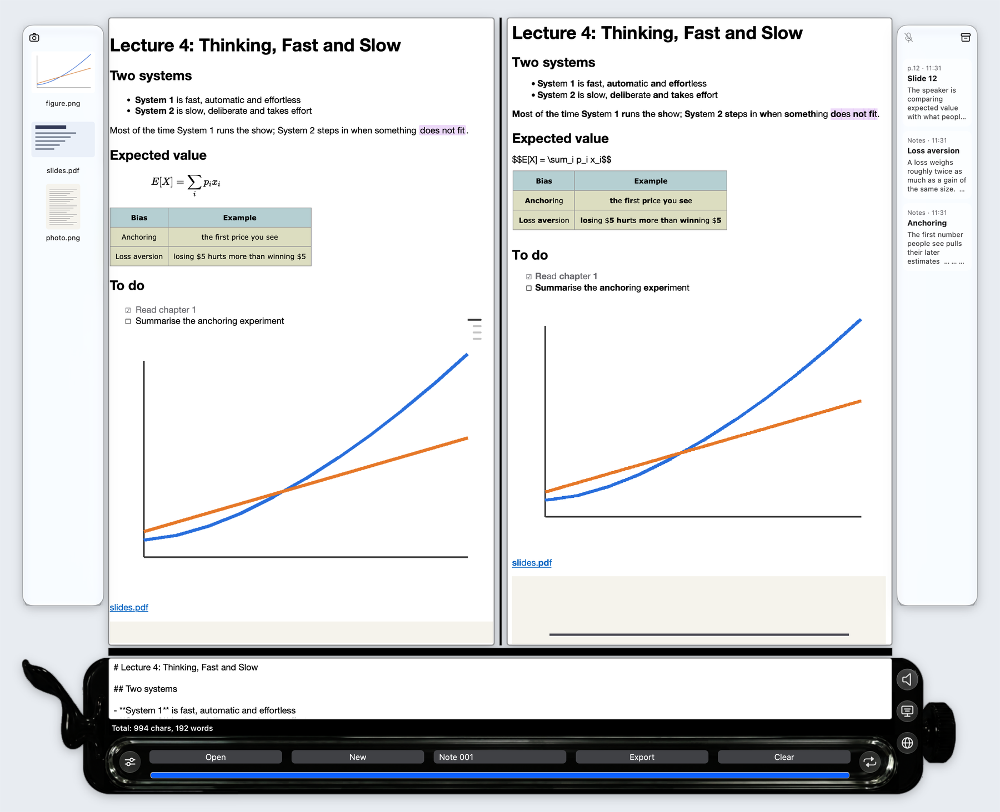
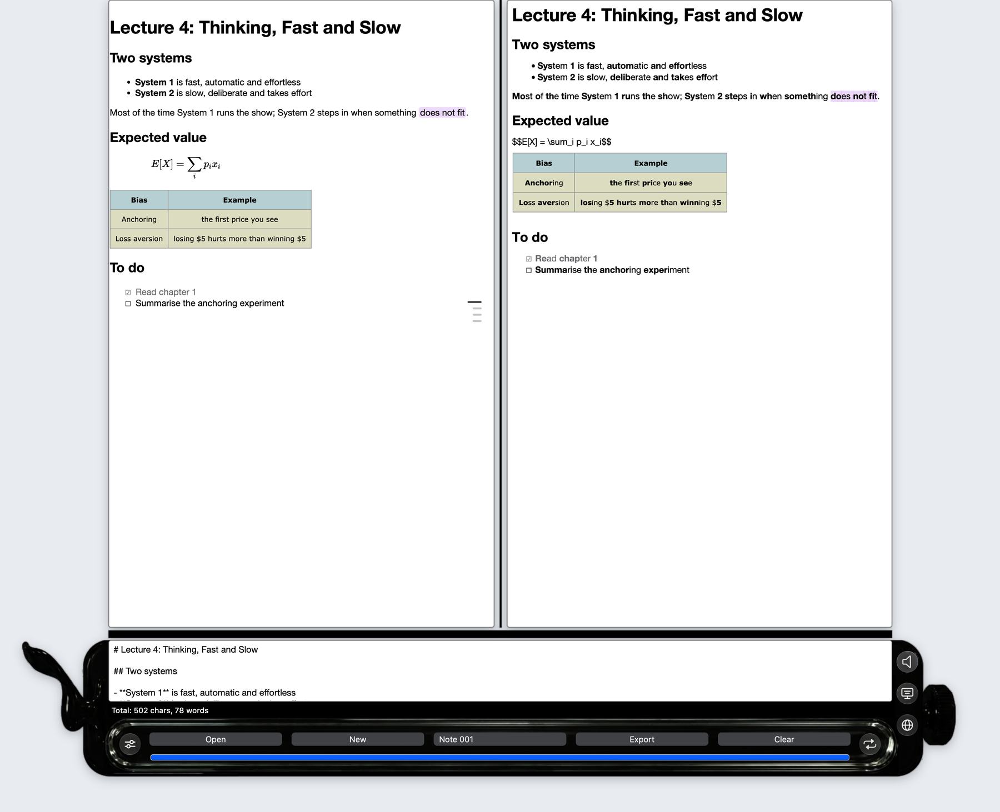
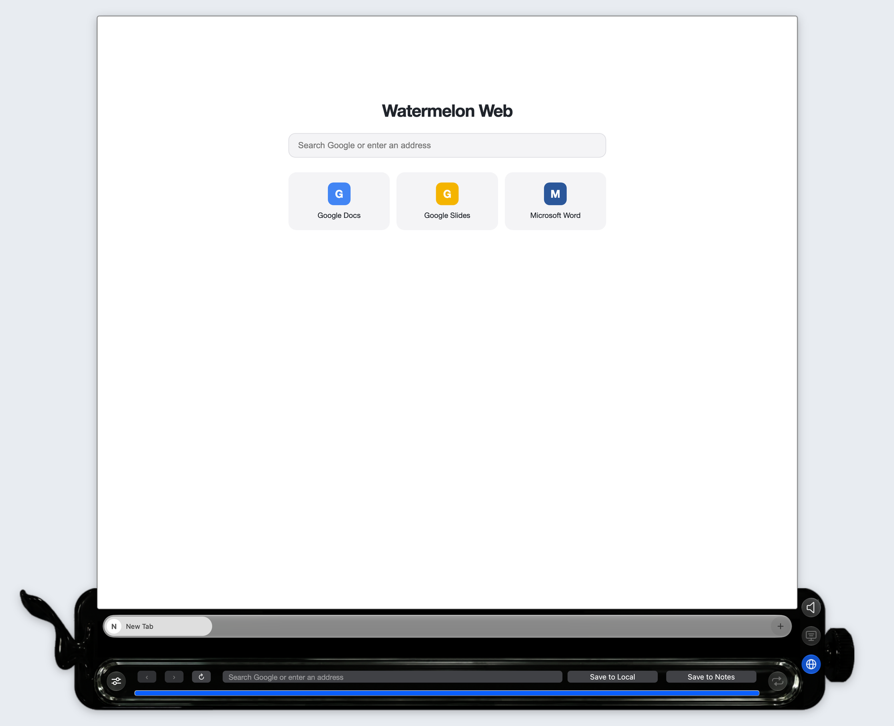

# 🍉Watermelon: A Markdown-based Tool for Bionic Reading

<p align="center"><a href="README.md">简体中文</a> · <b>English</b> · <a href="README_JA.md">日本語</a></p>

<p align="center">
  
</p>

**Watermelon is a Markdown typewriter that floats on the Mac desktop.** While you type, you see the laid-out page and its bionic-reading version. It syncs with Apple Notes both ways, edits Word / Excel / PowerPoint files in place and saves web pages as notes; in a lecture or a meeting, attachments, screenshots and photographed paper sit beside the editing area, and with [Broccoli](https://github.com/Ryan-the-hito/Broccoli) installed, explanation cards appear as you go. Local notes are ordinary Markdown files on your Mac.

Latest version: **v2.2.4** · Interface languages: English / 简体中文 / 日本語

## What it solves

Watermelon began with one job: turning the text on the clipboard into the bionic-reading format, so you read faster. It has since grown into a place to write, and now it is after three things:

1. **You cannot see how it reads while you write**

   Markdown is quick to write, but the screen is full of symbols while you do, and reading it means another app. Watermelon keeps three things in one window: you type below, the laid-out page is at the top left, and the bionic-reading version at the top right. English, Chinese and Japanese are all handled.

2. **Notes locked inside one app**

   Apple Notes is handy, but its formatting does not come out; Word files and documents on the web each live somewhere else. Watermelon's notes are plain Markdown files; it also syncs with Notes both ways and keeps Notes' own formatting, opens Office files in the same editing area, and saves a web page (Google Docs and Slides too) as a local document or a note with one click.

3. **In a lecture or a meeting, material and notes are apart**

   The slides are in one window, the notes in another, and what is said goes unrecorded. Watermelon lists the note's attachments left of the editing area, and keeps screenshots and photographed paper there too. On the right are AI cards: with Lecture Mode on, the page you are looking at, the passage just spoken and the paragraph you are writing go to Broccoli together, and explanation cards appear as you go, one click away from the note.

## Highlights

### The typewriter: three views

- **Editing area**: write Markdown. Changes are saved by themselves, and earlier versions are backed up ("💾 Backup Limit" in the menu bar menu sets how many are kept).
- **Live preview**: headings, lists, tables, code blocks and formulas, laid out. The formula engine is built in and needs no network. An outline strip on the page's right edge opens into the list of headings when the pointer rests on it; click one to go there.
- **Bionic reading**: the first part of every word in bold. On a long document only the part that changed is laid out again.
- Drag to resize the three parts. Typing sounds like a typewriter; a round button on the right turns the sound off.
- **Teleprompter Mode** ("📺 Teleprompter Mode" in the menu bar menu, or the round button on the right).

### Bionic reading for the clipboard and for files

- Copy some text and choose "🦾 Bold Text! (Clipboard)" in the menu bar menu: the text on the clipboard is now in the bionic-reading format, ready to paste into any Markdown editor; "💪 Unbold Text! (Clipboard)" turns it back.
- "📂️ Open a Markdown file" makes a bionic-reading version of a whole Markdown file.

### Apple Notes, both ways

- A button on the typewriter switches between local documents (Local) and Notes. Choose a note and you write it in Watermelon as Markdown; the changes go back to Notes.
- Notes' own formatting survives the round trip: quotes, checklists, subheadings, #tags, links, dividers, tables and code blocks, with attachments staying where they were.
- The note picker lists the newest notes first. The end of the word-count line shows whether the changes are saved.


The Markdown that syncs with Notes: headings, bold, italic, strikethrough, ordered and unordered lists (with nesting), tables (all columns centred), code blocks. LaTeX formulas are typeset in Watermelon's preview (Notes itself cannot render them). A full sample is in the [Chinese README](README.md).

### Word / Excel / PowerPoint

- Office files are switched with the same file drop-down as other documents, and open, edit and save back to the original file right in the editing area.

### Web mode

- The round Web button on the right turns the whole editing area into a web page with a tab bar; the start page has Google Docs, Google Slides and Microsoft Word, and sign-ins are kept.
- "Save to Local" and "Save to Notes" save the content of the page (Google Docs and Slides too) as a local document or a note with one click.

### The side panels: attachments and AI cards

- **Left**: the list of all attachments in this note, with thumbnails. Click one to preview it in its own small window, several at a time if you like; a PDF scrolls or turns page by page, and its text can be selected and copied. Word / Excel / PowerPoint are previewed with the system's Quick Look and open in the editing area with one button.
- Drag a file onto the list, the editor or the laid-out page to add it to the note. Right-click an attachment to take it out of the note (⌘Z brings it back; the file itself stays).
- **Right**: the AI card panel (needs Broccoli).
- Both panels come out and go back with a round handle that appears when the pointer rests at the edge of the editing area. They exactly fill the empty strip and never cover the editing area.

### Screenshots and photos as course material

- The camera at the top of the left list: choose an area the first time; after that each press takes the same area again. It works on every screen: the area is taken on the screen where you start dragging. The area is remembered across restarts.
- New screenshots wait in the list. They belong to the note that was open when they were taken, are still there after a restart, and go only when you delete them. Right-click one to insert it into the note, make a PDF of them (or add them to a PDF already in the note) or delete it; ⌘ / ⇧-click to choose several; or drag them straight into the editor.
- Photograph paper with the Mac's cameras (built-in, Desk View, iPhone Continuity Camera): the sheet is found, straightened and sharpened, and its text is read. In the PDF made from them the text is an invisible layer you can select, copy and search.

### Lecture Mode (needs Broccoli)

- "🎓 Lecture Mode" in the menu bar menu. While it is on, Watermelon hands Broccoli the page of the course material you are looking at, the passage just spoken (Broccoli's live transcript) and the paragraph you are writing, and explanation cards appear in the right panel. Cards are about what is happening now.
- One click puts a card into the note, and it is archived once inserted. Right-click to ask Broccoli about a card or about the selected text.
- Highlights, comments, sticky notes and speaker notes in PDF, Word, Excel and PowerPoint attachments show up as cards in the right panel, each one once.

### With Broccoli and other AI apps

This needs [Broccoli](https://github.com/Ryan-the-hito/Broccoli) installed. When it is not on the Mac, Watermelon offers the download first.

- "Send to Broccoli" in the editor's right-click menu: the selected text (or the whole note) goes to Broccoli as background material, together with the pictures, PDFs and other files it refers to. Broccoli opens a blank conversation and waits for your question.
- "Write Here with Broccoli…" in the editor's right-click menu: the whole note goes to Broccoli as background material and you tell Broccoli what to write; when it is done, the text is typed in at the spot you right-clicked. Editing elsewhere or switching notes meanwhile is fine. One ⌘Z takes it all out.
- "🃏 Make Anki Cards…": Broccoli makes Anki cards (front/back or cloze) from the selected text, optionally with pages of the attachments, saved in a deck folder you can import into Anki and add to later.
- Watermelon's main functions are 35 MCP tools: documents, the outline, attachments and screenshots, cards, Anki decks, Notes, web mode, settings and backups. With Broccoli installed they connect by themselves; for other AI apps, "🔌 Use in other AI apps…" in the menu bar menu copies the settings to paste into that app's MCP settings.

### Window

- Liquid Glass: the round buttons on the typewriter, the web tab bar and the side panels are system glass; standalone windows have the system's traffic lights; alerts and menus are the system's own.
- Switches in the menu bar menu: "👀 Show/Hide dock icon"; "🪟 Show on all Spaces" (on every desktop and over full-screen apps).
- With Stage Manager on, the main window is not pushed to the right.

### Kept on your Mac

All of Watermelon's data is in this folder:

```
~/Library/Application Support/com.ryanthehito.watermelon
```

- `WatermelonAppPath/`: the list of documents you opened, backups, Notes attachments, Anki decks and the web mode's sign-in data. Your Markdown documents stay where you saved them.
- `Resources/`: settings.

"🗂️ Open Current Backup Folder" in the menu bar menu opens the backup folder of the current document.

Coming from 2.2.3 or earlier, what is in `~/WatermelonAppPath` and the settings that used to be written inside the app are moved here by themselves on first start. Nothing is written into the app any more.

## Screenshots

1. The typewriter: type below; the laid-out page at the top left, the bionic-reading version at the top right.

<p align="center">
  
</p>

2. The side panels: the note's attachments on the left, AI cards on the right.

<p align="center">
  
</p>

3. Web mode: the editing area becomes a web page; below it the tab bar, the address bar and "Save to Local" / "Save to Notes".

<p align="center">
  
</p>

Screenshots of 2.2.3 and earlier are kept, folded, in the [Chinese README](README.md).

## Requirements

- A Mac with Apple silicon (M series).
- macOS 14.4 or newer. Developed and tested on macOS 27; the Liquid Glass look needs macOS 26 or newer, and earlier systems get the same shapes in the ordinary look.
- Lecture Mode, Send to Broccoli, Write Here with Broccoli and Anki cards need [Broccoli](https://github.com/Ryan-the-hito/Broccoli) (Write Here needs Broccoli 566 or newer); everything else works without it.
- A working network connection is up to you.

## Price

Free.

p.s.: The app now is fully free, but whether I keep it free in the future depends on my future economic condition. It has been free for the past few years and I don't know about my future. Maybe it will become a paid app one day, but I will keep it free as long as I can. Thanks for your support!

## Install

1. Download the latest DMG from [Releases](https://github.com/Ryan-the-hito/Watermelon/releases) (for example `Watermelon_v2.2.4.1.dmg`).
2. Open the DMG and drag Watermelon into the Applications folder.
3. Open Watermelon. A 🍉 icon appears in the menu bar; "✍️ Watermelon Typewriter" in its menu opens the typewriter.
4. Give Watermelon the permissions you need in System Settings › Privacy & Security:
   - **Automation** (Notes): to sync with Notes. The system asks the first time.
   - **Full Disk Access**: to read Notes' own formatting (checkboxes, highlights and so on).
   - **Screen Recording**: so screenshots for course material can include other apps' windows.
   - **Camera**: to photograph paper. The system asks the first time.
5. **Updating later**: Watermelon checks once in the background after it starts; when there is a newer version the update window opens by itself, and "Update Now" downloads, checks, replaces and reopens it. Your settings and notes stay. "🆕 Check for Updates" in the menu bar menu checks at any time.
   - Coming from 2.2.3 or earlier, **install by hand once**: the app's identifier is now `com.ryanthehito.watermelon`, and the old one-click update cannot install it. Afterwards, give the permissions above once more.

## History

- **v2.2.4**: Liquid Glass, English / Chinese / Japanese interface, attachment list and previews, screenshots and photos as course material, Lecture Mode, Send to Broccoli, Write Here with Broccoli, Anki cards, MCP tools, Notes' own formatting both ways, Office files, web mode, faster bionic reading, one-click update.
- **v2.2.3** and earlier: see [Releases](https://github.com/Ryan-the-hito/Watermelon/releases).

## How to use

1. **Open the typewriter**: choose "✍️ Watermelon Typewriter" in the 🍉 menu. The editing area is below, the laid-out page at the top left, the bionic-reading version at the top right; drag between them to resize.

2. **Switch documents**: the file drop-down holds the documents you opened, Markdown and Word / Excel / PowerPoint alike. Switch to Notes and you are writing a note.

3. **Just make some text bionic**: copy it, choose "🦾 Bold Text! (Clipboard)" in the menu bar menu, and paste it where you want it.

4. **Add an attachment**: drag a file into the editor. Move the pointer to the left edge of the editing area and pull out the round handle: that is the note's attachment list; click an attachment to preview it in a small window.

5. **Screenshots as course material**: press the camera at the top of the attachment list and frame the area where the slides are; after that, press the camera once for every new slide. After class, select the screenshots and right-click to make one PDF in the note.

6. **In a lecture**: open Broccoli and choose "🎓 Lecture Mode" in the menu bar menu. Move the pointer to the right edge of the editing area and pull out the card panel; explanation cards come one by one, and a click puts a useful one into the note.

7. **Let Broccoli write a passage**: right-click in the editor where the text should go, choose "Write Here with Broccoli…", and tell Broccoli what to write in the window that comes up. The finished text is typed in at that spot.

8. **Web mode**: press the round Web button right of the typewriter. To keep what you read, press "Save to Local" or "Save to Notes".

9. **Language and settings**: "🌐 Language" in the menu bar menu (after a restart) and "⚙️ Settings" (font, recent files and more).

## Notes

1. Coming from 2.2.3 or earlier: install by hand once and give the permissions again; data and settings move to the new place by themselves.
2. Reading checkboxes, highlights and other formatting of Notes needs Full Disk Access; without it, text and basic formatting still sync.
3. Tables in Notes are centred in every column; two lists need a line of ordinary text between them, or they are taken as one list.
4. The live transcript in Lecture Mode comes from Broccoli's voice input; turn that on in Broccoli first.
5. The built-in Office editing component is under AGPL-3.0; its licence file is inside the app.

## Q&A

If you run into anything unusual, see **[Q&A](https://github.com/Ryan-the-hito/Q-A)❓** for a ready answer, or get in touch with me.

## License

GPL-3.0 license

## Thanks

1. [Qt](https://github.com/qt): this app follows Qt's open-source licence.
2. [ranuts/document](https://github.com/ranuts/document): the Office editing component (AGPL-3.0).
3. [MathJax](https://github.com/mathjax/MathJax): formulas (Apache-2.0).
4. [jieba](https://github.com/fxsjy/jieba): Chinese word segmentation (MIT).

## Support the author

[Buy Me a Cup of Coffee](https://www.buymeacoffee.com/ryanthehito)

<p align="center">
  
  
</p>
