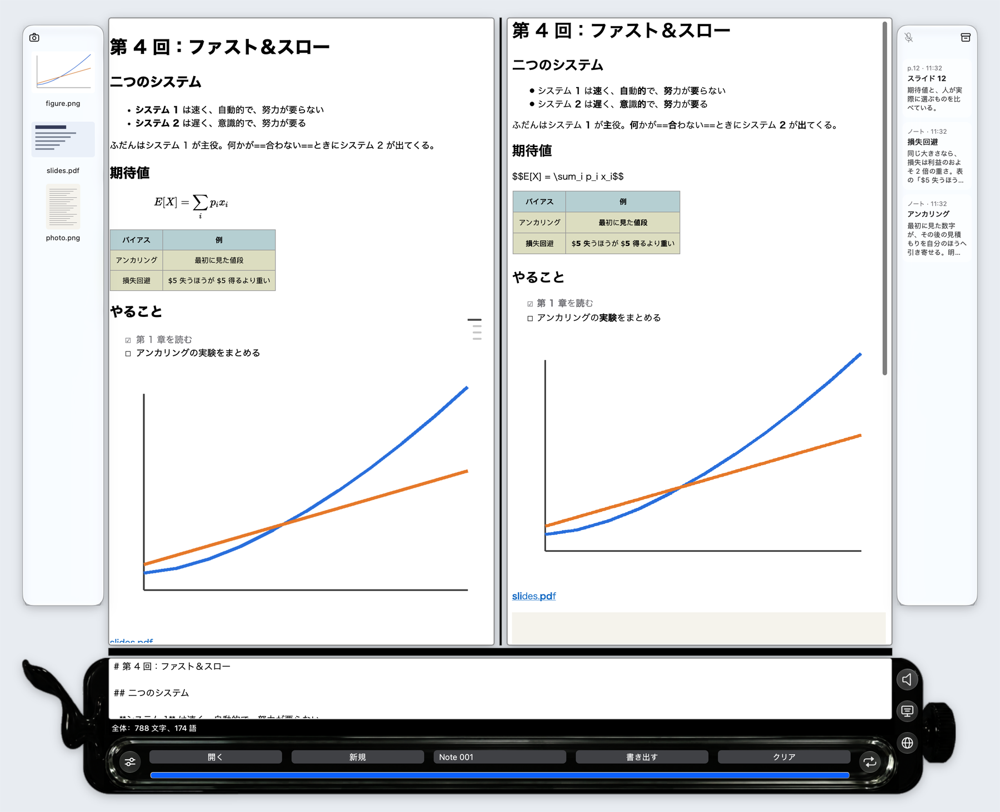
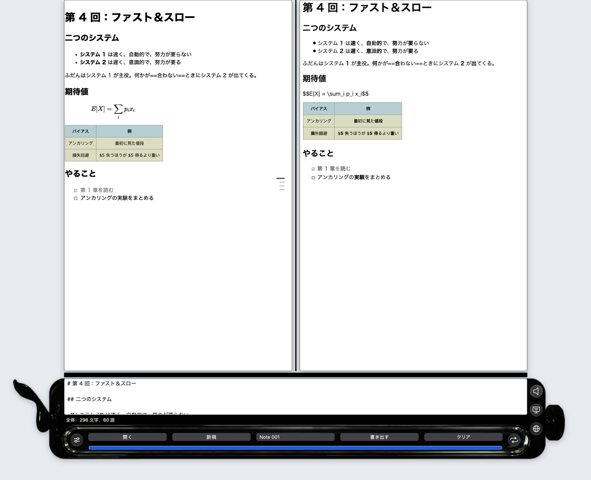
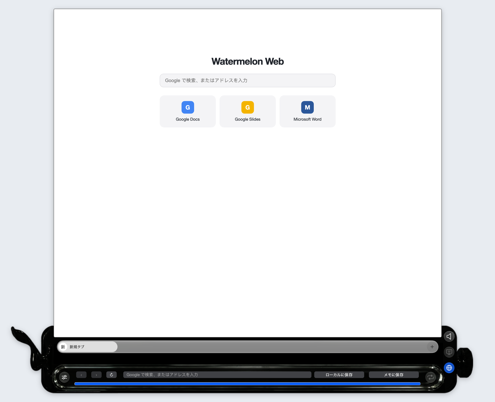

# 🍉Watermelon: A Markdown-based Tool for Bionic Reading

<p align="center"><a href="README.md">简体中文</a> · <a href="README_EN.md">English</a> · <b>日本語</b></p>

<p align="center">
  
</p>

**Watermelon は Mac のデスクトップに浮かぶ Markdown のタイプライターです。** 入力しながら、整形されたページと「太字リーディング」（Bionic Reading）の表示を同時に見られます。Apple のメモと双方向に同期し、Word / Excel / PowerPoint をその場で編集し、Web ページをノートとして保存できます。講義や会議では、添付ファイル、スクリーンショット、撮影した紙が編集エリアの横にまとまり、[Broccoli](https://github.com/Ryan-the-hito/Broccoli) を入れていれば解説カードがその場で出てきます。ローカルのノートは、Mac にある普通の Markdown ファイルです。

最新バージョン：**v2.2.4** · 画面の言語：English / 简体中文 / 日本語

## 解決したいこと

Watermelon は最初、クリップボードの文章を太字リーディングの形式に変えて速く読めるようにする、という一つの仕事だけをしていました。その後、書くための場所に育ち、いまは三つのことを解決しようとしています。

1. **書いているあいだ、読むときの姿が見えない**

   Markdown は速く書けますが、書いているあいだは記号だらけで、読むには別のアプリが要ります。Watermelon は三つを一つのウインドウに置きます。下で入力し、左上に整形されたページ、右上に太字リーディングの表示。日本語、英語、中国語のどれでも太字にできます。

2. **ノートが一つのアプリに閉じ込められる**

   Apple のメモは便利ですが、書式を外に出せません。Word のファイルや Web 上の文書も、それぞれ別の場所にあります。Watermelon のノートは普通の Markdown ファイルです。そのうえでメモと双方向に同期してメモ本来の書式を保ち、同じ編集エリアで Office ファイルを開き、Web ページ（Google ドキュメントやスライドも）をワンクリックでローカルの文書やメモとして保存できます。

3. **講義や会議で、資料とノートが離れている**

   資料は一つのウインドウ、ノートは別のウインドウ、話された内容は残りません。Watermelon は、このノートの添付ファイルを編集エリアの左に並べ、スクリーンショットや撮影した紙もそこに置きます。右は AI カードです。講義モードをオンにすると、いま見ているページ、話し終えたひとまとまり、いま書いている段落がまとめて Broccoli に渡り、解説カードがその場で現れて、ワンクリックでノートに入ります。

## 主な機能

### タイプライター：三つの表示

- **編集エリア**：Markdown を書きます。変更は自動で保存され、以前の版は自動でバックアップされます（メニューバーのメニュー「💾 バックアップの上限」で残す数を決めます）。
- **リアルタイムのプレビュー**：見出し、リスト、表、コードブロック、数式を整形して表示します。数式エンジンは同梱で、ネットワークを使いません。ページの右端に見出しの目盛りが並び、ポインタを置くと見出しの一覧に広がって、クリックでそこへ移動します。
- **太字リーディング**：各語の前半を太字にします。長い文書では、変わった部分だけを組み直します。
- 三つの部分の大きさはドラッグで変えられます。入力するとタイプライターの音がします。右の丸ボタンで音を消せます。
- **プロンプターモード**（メニューバーのメニュー「📺 プロンプターモード」、または右の丸ボタン）。

### クリップボードとファイルの太字リーディング

- 文章をコピーして、メニューバーのメニュー「🦾 太字にする！（クリップボード）」を選ぶと、クリップボードの文章が太字リーディングの形式になり、どの Markdown エディタにも貼り付けられます。「💪 太字を解除！（クリップボード）」で元に戻ります。
- 「📂️ Markdown ファイルを開く」：Markdown ファイルを丸ごと太字リーディングの版にします。

### Apple のメモと双方向

- タイプライターのボタンで、ローカルの文書（Local）とメモ（Notes）を切り替えます。メモを一つ選ぶと、Watermelon で Markdown として書け、変更はメモに戻ります。
- 双方向の同期でメモ本来の書式が保たれます：引用、チェックリスト、小見出し、#タグ、リンク、区切り線、表、コードブロック。添付ファイルは元の位置に残ります。
- ノートを選ぶ一覧では、新しく作ったものがいちばん上に並びます。文字数の行の末尾に保存の状態が表示されます。


メモと同期できる Markdown：見出し、太字、斜体、取り消し線、番号付き・番号なしのリスト（入れ子も）、表（すべての列が中央揃え）、コードブロック。LaTeX の数式は Watermelon のプレビューで組まれます（メモ自体は表示できません）。全体のサンプルは[中国語の README](README.md) にあります。

### Word / Excel / PowerPoint

- Office ファイルは、ほかの文書と同じファイルのプルダウンで切り替え、編集エリアでそのまま開いて編集でき、元のファイルに自動で保存されます。

### Web モード

- 右の Web の丸ボタンで、編集エリア全体がタブバー付きの Web ページに変わります。スタートページに Google Docs、Google Slides、Microsoft Word への入口があり、ログイン状態は保たれます。
- 「ローカルに保存」「メモに保存」：いまの Web ページの内容（Google ドキュメントやスライドも）を、ワンクリックでローカルの文書やメモとして保存します。

### 左右のパネル：添付ファイルと AI カード

- **左**：このノートの添付ファイルの一覧（サムネイル付き）。クリックすると小さな独立ウインドウでプレビューでき、いくつも同時に開けます。PDF は上下スクロールでも 1 ページずつでもめくれ、文字をドラッグで選んでコピーできます。Word / Excel / PowerPoint はシステムの「クイックルック」でプレビューし、ボタン一つで編集エリアに開けます。
- ファイルを一覧、編集欄、整形済みページにドラッグすると、ノートに添付として加わります。添付は右クリックでノートから取り除けます（⌘Z で戻せます。ファイル自体はそのまま）。
- **右**：AI カードのパネル（Broccoli が必要です）。
- 二つのパネルは、編集エリアの端にポインタを置くと現れる丸いハンドルで出し入れします。幅は空いた帯にちょうど収まり、編集エリアには重なりません。

### スクリーンショットと撮影を講義資料に

- 左の一覧の上のカメラ：最初に範囲を選ぶと、以後は押すたびに同じ範囲を撮ります。ディスプレイが何台あっても選べ、押したディスプレイが撮影されます。範囲は再起動後も覚えています。
- 撮った画像はまず一覧に入り、撮ったときに開いていたノートに属し、再起動後も残り、自分で削除するまで消えません。それぞれ右クリックでノートに挿入、PDF にまとめる（ノートにある PDF の後ろに追加も可）、削除ができます。⌘ / ⇧ クリックで複数選択でき、編集欄へ直接ドラッグもできます。
- Mac のカメラで紙を撮影（内蔵カメラ、机を写す Desk View、iPhone の連係カメラ）：紙を自動で見つけて正面に直し、くっきりさせ、文字も読み取ります。まとめた PDF には見えない文字の層があり、選択・コピー・検索ができます。

### 講義モード（Broccoli が必要です）

- メニューバーのメニューの「🎓 講義モード」。オンにすると、いま見ている資料のページ、話し終えたひとまとまり（Broccoli のリアルタイム書き起こし）、いま書いているノートの段落を Broccoli に渡し、右のパネルに解説カードが出ます。カードは「いま」の内容だけを扱います。
- カードはワンクリックでノートに挿入でき、挿入すると自動でアーカイブされます。右クリックで、そのカードや選んだ文字について Broccoli に質問できます。
- PDF・Word・Excel・PowerPoint に付いたハイライト、コメント、付箋、発表者ノートは、右のパネルにカードとして表示されます。1 件につき 1 回だけです。

### Broccoli やほかの AI アプリと一緒に

[Broccoli](https://github.com/Ryan-the-hito/Broccoli) のインストールが必要です。Mac にないときは、Watermelon が先にダウンロードを案内します。

- 編集欄の右クリック「Broccoli に送る」：選んだ文字（選んでいなければ全文）を背景資料として Broccoli に渡します。文中で参照している画像や PDF などのファイルも一緒に渡ります。Broccoli は空の会話を開いて質問を待ちます。
- 編集欄の右クリック「Broccoli にここへ書いてもらう…」：ノート全体を背景資料として Broccoli に渡し、Broccoli で何を書くか伝えます。書き上がると、右クリックした位置に自動で入力されます。途中でほかの所を直したり別のノートに切り替えたりしても大丈夫です。⌘Z 一回でまとめて取り消せます。
- 「🃏 Anki カードを作成…」：選んだ文字（添付ファイルの数ページを加えることもできます）から、Broccoli が Anki カード（表裏または穴埋め）を作ります。デッキのフォルダに保存され、Anki に読み込めて、あとから同じデッキに追加もできます。
- Watermelon の主な機能は 35 個の MCP ツールになっています：文書、アウトライン、添付ファイルとスクリーンショット、カード、Anki デッキ、メモ、Web モード、設定、バックアップ。Broccoli を入れていれば自動でつながります。ほかの AI アプリは、メニューバーのメニュー「🔌 ほかの AI アプリで使う…」で設定をコピーし、そのアプリの MCP 設定に貼り付けます。

### ウインドウ

- Liquid Glass の外観：タイプライターの丸ボタン、Web のタブバー、サイドパネルはシステムのガラス、独立したウインドウはシステムの信号ボタン付き、通知とメニューはシステム標準です。
- メニューバーのメニューのスイッチ：「👀 Dock アイコンを表示/非表示」Dock アイコンの表示・非表示、「🪟 すべての操作スペースに表示」すべてのデスクトップとフルスクリーンのアプリの上に表示。
- ステージマネージャをオンにしていても、メインウインドウは右へ押されません。

### データは Mac の中に

Watermelon のデータはすべてこのフォルダにあります：

```
~/Library/Application Support/com.ryanthehito.watermelon
```

- `WatermelonAppPath/`：開いた文書の一覧、バックアップ、メモの添付ファイル、Anki デッキ、Web モードのログインデータ。Markdown の文書は、自分で保存した場所にそのまま残ります。
- `Resources/`：設定。

メニューバーのメニュー「🗂️ 現在のバックアップフォルダを開く」で、いまの文書のバックアップフォルダを直接開けます。

2.2.3 以前から更新した場合、`~/WatermelonAppPath` の内容と、以前アプリ本体に書かれていた設定は、初回起動時に自動で移されます。アプリ本体にはもう何も書き込みません。

## 画面

1. タイプライター：下で入力し、左上に整形されたページ、右上に太字リーディングの表示。

<p align="center">
  
</p>

2. 左右のパネル：左にこのノートの添付ファイル、右に AI カード。

<p align="center">
  
</p>

3. Web モード：編集エリアが Web ページに変わり、下にタブバー、アドレス欄、「ローカルに保存」「メモに保存」があります。

<p align="center">
  
</p>

2.2.3 以前のスクリーンショットは、[中国語の README](README.md) に折りたたんで残してあります。

## 動作環境

- Apple シリコン（M シリーズ）の Mac。
- macOS 14.4 以降。macOS 27 で開発・テストしています。Liquid Glass の外観は macOS 26 以降で、それより前のシステムでは同じ形の通常の外観になります。
- 講義モード、Broccoli に送る、Broccoli にここへ書いてもらう、Anki カードには [Broccoli](https://github.com/Ryan-the-hito/Broccoli) が必要です（ここへ書いてもらう機能は Broccoli 566 以降）。Broccoli がなくても、ほかの機能はそのまま使えます。
- ネットワーク環境は各自でご用意ください。

## 価格

Free.

p.s.: The app now is fully free, but whether I keep it free in the future depends on my future economic condition. It has been free for the past few years and I don't know about my future. Maybe it will become a paid app one day, but I will keep it free as long as I can. Thanks for your support!

## インストール

1. [Releases](https://github.com/Ryan-the-hito/Watermelon/releases) から最新の DMG をダウンロードします（例：`Watermelon_v2.2.4.1.dmg`）。
2. DMG を開き、Watermelon を「アプリケーション」フォルダにドラッグします。
3. Watermelon を開きます。メニューバーに 🍉 アイコンが現れます。メニューの「✍️ Watermelon タイプライター」でタイプライターが開きます。
4. 必要に応じて「システム設定 › プライバシーとセキュリティ」で Watermelon に許可を与えます：
   - **オートメーション**（メモの制御）：メモとの同期。初めて使うときにシステムが尋ねます。
   - **フルディスクアクセス**：メモ本来の書式（チェックボックス、ハイライトなど）の読み取り。
   - **画面収録**：講義資料用のスクリーンショットに、ほかのアプリのウインドウを写すため。
   - **カメラ**：紙の撮影。初めて使うときにシステムが尋ねます。
5. **以後のアップデート**：Watermelon は起動後にバックグラウンドで一度確認し、新しいバージョンがあればアップデートウインドウが自動で開きます。「今すぐ更新」を押すと、ダウンロード、検証、入れ替え、再起動まで行います。設定とノートはそのままです。メニューバーのメニュー「🆕 アップデートを確認」でいつでも確認できます。
   - 2.2.3 以前から更新する場合は、**一度手動でインストール**してください。アプリの識別子が `com.ryanthehito.watermelon` に変わったため、古いバージョンのワンクリック更新では入れられません。インストール後、上の許可をもう一度与えてください。

## 更新履歴

- **v2.2.4**：Liquid Glass の外観、日本語・中国語・英語の画面、添付ファイルの一覧とプレビュー、スクリーンショットと撮影を講義資料に、講義モード、Broccoli に送る、Broccoli にここへ書いてもらう、Anki カード、MCP ツール、メモ本来の書式での双方向同期、Office ファイルの編集、Web モード、太字リーディングの高速化、ワンクリック更新。
- **v2.2.3** 以前：[Releases](https://github.com/Ryan-the-hito/Watermelon/releases) を参照。

## 使い方

1. **タイプライターを開く**：メニューバーの 🍉 メニューの「✍️ Watermelon タイプライター」を選びます。下が編集エリア、左上が整形されたページ、右上が太字リーディングの表示です。あいだの仕切りをドラッグすると、三つの大きさを変えられます。

2. **文書を切り替える**：ファイルのプルダウンに、開いたことのある文書が並びます。Markdown も Word / Excel / PowerPoint も入っています。Notes に切り替えると、メモを書くことになります。

3. **文章を太字にしたいだけのとき**：文章をコピーし、メニューバーのメニュー「🦾 太字にする！（クリップボード）」を選んで、使いたい場所に貼り付けます。

4. **添付ファイルを加える**：ファイルを編集欄にドラッグします。ポインタを編集エリアの左端に置いて丸いハンドルを引き出すと、このノートの添付ファイルの一覧が出ます。添付をクリックすると小さなウインドウでプレビューできます。

5. **スクリーンショットを講義資料にする**：添付ファイルの一覧の上のカメラを押し、資料のある範囲を選びます。以後はページが変わるたびにカメラを 1 回押します。講義のあと、スクリーンショットを複数選んで右クリックし、1 つの PDF にまとめてノートに入れます。

6. **講義を聞く**：Broccoli を開き、メニューバーのメニュー「🎓 講義モード」を選びます。ポインタを編集エリアの右端に置いてカードのパネルを引き出すと、解説カードが 1 枚ずつ現れます。役に立つものはクリックでノートに挿入します。

7. **Broccoli に一段落書いてもらう**：編集欄の、書いてほしい位置で右クリックし、「Broccoli にここへ書いてもらう…」を選んで、出てきた Broccoli に何を書くか伝えます。書き上がった文章は、その位置に自動で入力されます。

8. **Web モード**：タイプライターの右にある Web の丸ボタンを押します。読んだものを残したいときは「ローカルに保存」または「メモに保存」を押します。

9. **言語と設定を変える**：メニューバーのメニュー「🌐 言語」（再起動後に反映）と「⚙️ 設定」（フォント、最近のファイルなど）。

## 注意

1. 2.2.3 以前から更新する場合：一度手動でインストールし、許可をもう一度与えてください。データと設定は自動で新しい場所に移ります。
2. メモのチェックボックスやハイライトなどの書式を読むには「フルディスクアクセス」が必要です。なくても、文字と基本的な書式は同期できます。
3. メモの表はすべての列が中央揃えになります。二つのリストのあいだにはリストでない行が必要で、ないと一つのリストとして扱われます。
4. 講義モードの書き起こしは Broccoli の音声入力から届きます。先に Broccoli でオンにしてください。
5. 同梱の Office 編集コンポーネントは AGPL-3.0 ライセンスで、ライセンスファイルはアプリの中にあります。

## Q&A

特殊な状況に出会ったら、**[Q&A](https://github.com/Ryan-the-hito/Q-A)❓** に解決方法がないか確認するか、ご連絡ください。

## ライセンス

GPL-3.0 license

## 謝辞

1. [Qt](https://github.com/qt)：このアプリは Qt のオープンソースライセンスに従います。
2. [ranuts/document](https://github.com/ranuts/document)：Office ファイルの編集コンポーネント（AGPL-3.0）。
3. [MathJax](https://github.com/mathjax/MathJax)：数式の組版（Apache-2.0）。
4. [jieba](https://github.com/fxsjy/jieba)：中国語の単語分割（MIT）。

## 作者を支援する

[Buy Me a Cup of Coffee](https://www.buymeacoffee.com/ryanthehito)

<p align="center">
  
  
</p>
